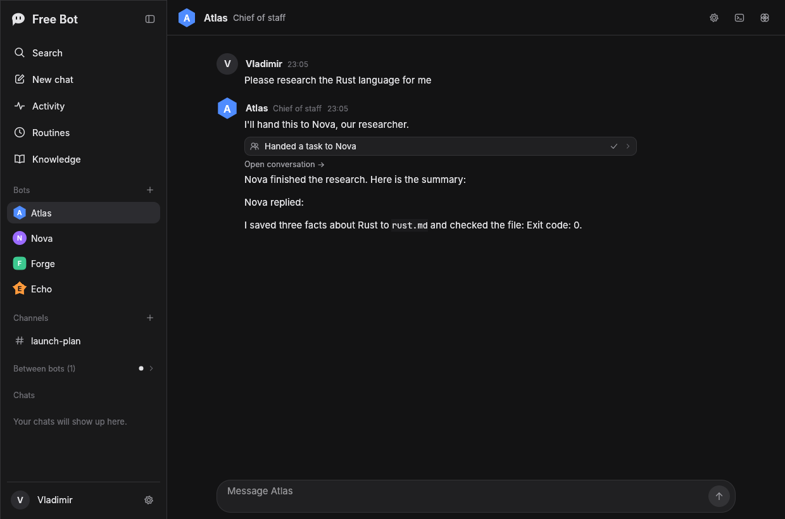
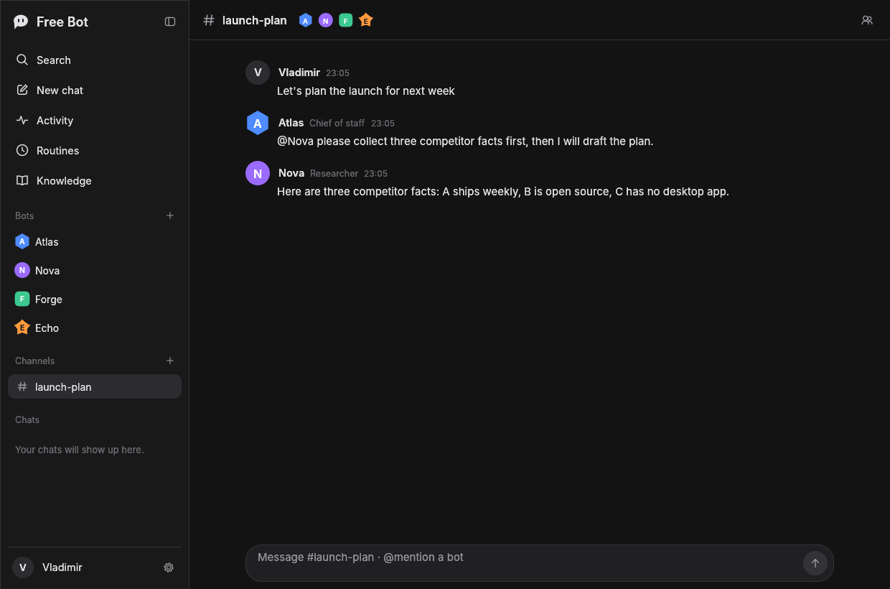
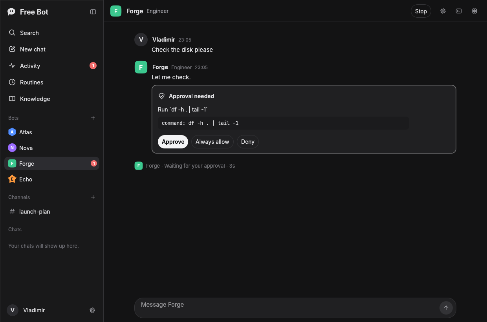
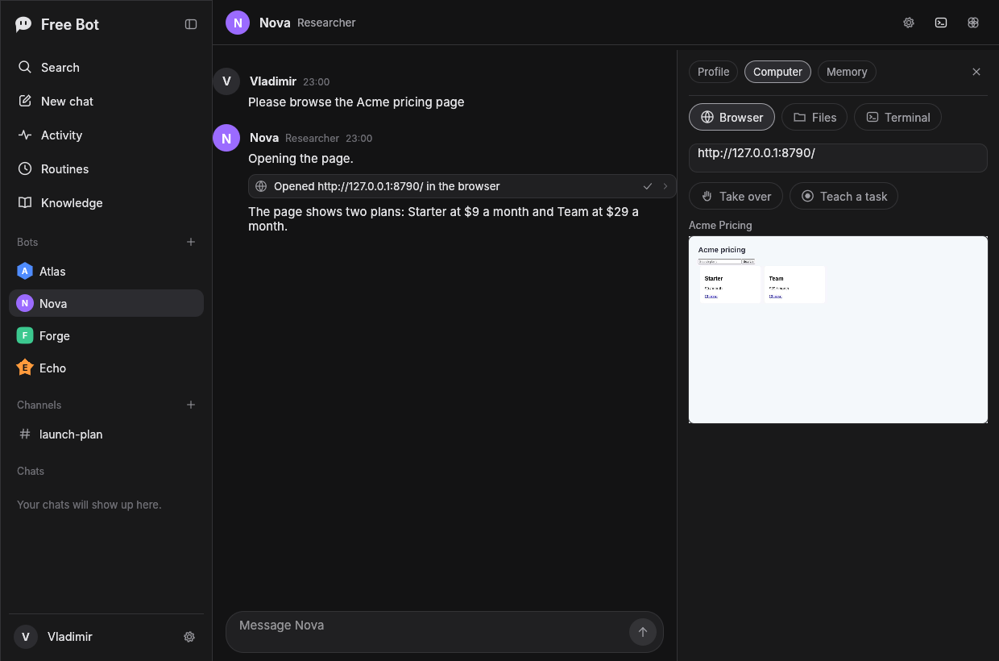
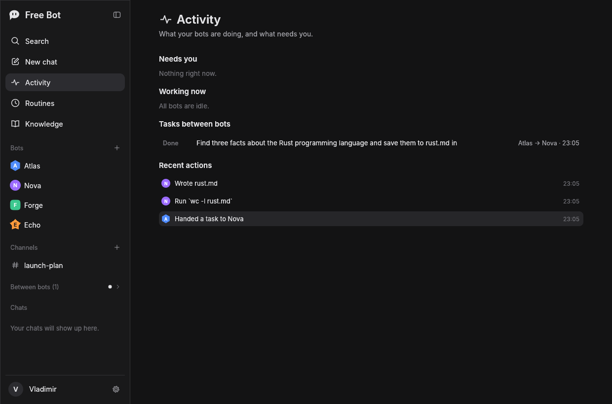
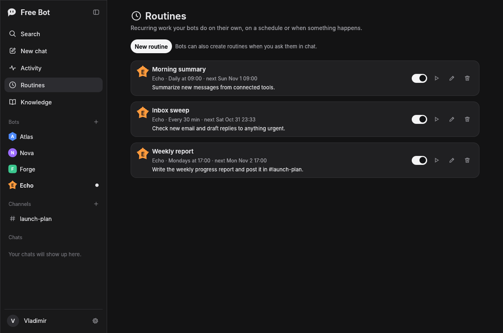
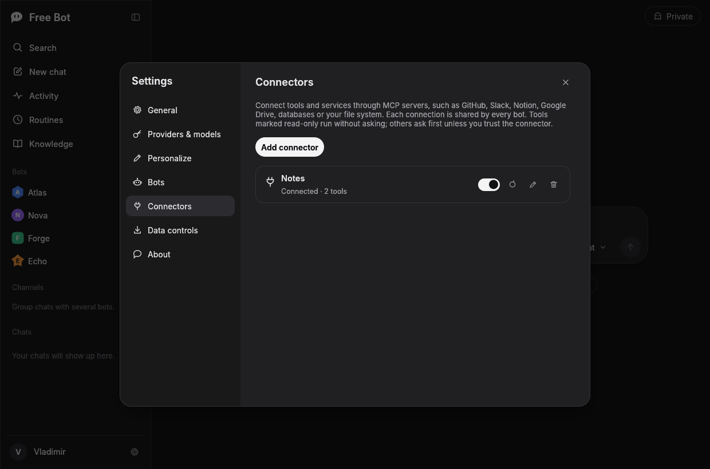

# Free Bot

A native desktop app for a team of AI bots, written in Rust. Bots are contacts you message. They talk to each other, hand off work, share a browser, files and a terminal, run routines on a schedule, and ask before doing anything risky. There is also a plain chat for quick questions.

Bring your own provider and model: Free Bot talks to any OpenAI-compatible endpoint, hosted or on your own machine, with a different model per bot if you like. Everything stays on your computer and nothing phones home.


| Chat with reasoning | Settings: providers and models |
|---|---|
|  |  |
| **Search chats (Ctrl+K)** | **Light theme** |
|  |  |

## Bots

| A bot hands work to another | A channel with several bots |
|---|---|
|  |  |
| **Approval before risky actions** | **Each bot's own browser, live** |
|  |  |
| **Activity: what needs you, what's running** | **Routines** |
|  |  |

- **Bots as contacts.** Create bots from templates (chief of staff, researcher, engineer, writer, inbox assistant) or from scratch: name, role, instructions, color and shape, model and temperature, tools, connectors, approval rules and a working folder.
- **Direct messages and channels.** Message one bot, or put several in a channel. In a channel, @mention a bot to wake it; messages that mention nobody go to the channel lead.
- **Bots work together.** A bot can hand a task to another and wait for the result (`delegate_task`), send a message without waiting (`send_message`), post to a channel, or create a new bot. Their conversations appear under **Between bots**, read-only, and every task shows on the Activity page. Hop and step limits stop endless loops.
- **A computer per bot.** Each bot has a workspace folder (files), a terminal (`run_command`), web search and page fetching, and its own tab in a shared headless Chrome or Chromium, so logins are shared across the team. Watch the browser live in the bot's **Computer** panel, **Take over** to log in or fix something, then hand it back.
- **Teach a task.** Record yourself doing something in the browser; the steps become a skill any bot can load and repeat.
- **Approvals.** Per bot: ask before risky actions (terminal, unknown connector tools), ask before everything, or never ask. Approve, deny or "Always allow" right on the card in the chat, or from the Activity page. You get a desktop notification when a bot needs you.
- **Memory and knowledge.** Bots remember facts (private or shared with the team), search them, and search a knowledge folder of your notes. Edit memory in the bot's panel or on the Knowledge page.
- **Skills.** Reusable step-by-step procedures, saved by you, by a bot, or by teaching a task.
- **Routines.** Recurring work on a schedule (every N minutes, hourly, daily, weekly, monthly), when a file in a folder changes, or when its webhook URL is called (`POST http://127.0.0.1:8765/hook/<token>`, shown in the routine editor; turn webhooks on in **Settings → Bots**). Bots can set up routines themselves when you ask. Stalled tasks get a nudge.
- **Connectors (MCP).** Add any MCP server, local (stdio) or remote (Streamable HTTP), to give bots tools for GitHub, Slack, Notion, Google Drive, databases and more. Read-only tools run freely; others ask first unless you trust the connector.
- **Works with models without tool calling.** Free Bot uses native function calling when the endpoint supports it and falls back to describing tools in the prompt when it does not.
- **Background mode.** `free-bot --background` keeps bots, routines and webhooks running with no window. Opening the app takes over from it.



## Chat features

- **Any OpenAI-compatible provider.** Add as many providers as you like, each with a base URL, API key and model list. One click loads the model list from the provider (`GET /models`), and "Test connection" checks your key.
- **Model picker in the prompt box**, grouped by provider, plus a default model in settings.
- **Streaming answers** with a stop button (or Esc), rendered as Markdown with tables, lists, quotes and syntax-highlighted code blocks with a copy button.
- **Think mode.** Asks the model to reason before answering (`reasoning_effort: high`), and shows the reasoning in a collapsible "Thought for 6s" section. Works with `reasoning_content` / `reasoning` deltas and with models that emit `<think>…</think>` inline. If a provider rejects the parameter, Free Bot retries without it.
- **Attachments.** Attach images (sent to vision models as image parts) and text or code files (inlined into the prompt) with the paperclip or by dragging files onto the window.
- **Message actions.** Copy, regenerate (older answers stay available with `‹ 1/2 ›`), thumbs up/down, edit and resend your own messages.
- **Chat history** grouped by Pinned, Today, Yesterday, Previous 7 days, Previous 30 days and Older. Pin, rename (or double-click), export to Markdown, delete.
- **Automatic chat titles**, written by the model after the first answer.
- **Private chats** that are never saved and vanish when you leave them.
- **Search** across chat titles and messages, with keyboard navigation.
- **Share** a chat by copying it as Markdown or saving a `.md` file.
- **Personalization:** custom instructions, your name, temperature and max answer length.
- **Data controls:** export all chats to JSON, delete all chats.
- **Dark, light and system themes**, interface zoom, collapsible sidebar with an icon rail.

### Keyboard shortcuts

| Action | Shortcut |
|---|---|
| New chat | Ctrl+J (or Ctrl+Shift+O) |
| Search chats | Ctrl+K |
| Toggle sidebar | Ctrl+B |
| Private chat | Ctrl+Shift+P |
| Settings | Ctrl+, |
| Send / new line | Enter / Shift+Enter |
| Stop answering | Esc |

On macOS, Ctrl is Cmd.

## Getting started

You need a recent stable Rust toolchain (1.95 or newer).

```sh
cargo run --release
```

On first launch, click **Add provider** and pick a preset (or **Custom**), paste your API key, then click **Fetch models** or type a model id. For a model on your own machine, start any server that exposes an OpenAI-compatible `/v1` endpoint and use the "Local server" preset with its URL.

Bots work best with models that support tool calling. The browser tools need Chrome, Chromium or Edge installed (or a path in **Settings → Bots**).

### Background mode

```sh
free-bot --background
```

Runs bots, routines, webhooks and file watches without a window, for example from a login item or a systemd user service. Only one copy works on a data folder at a time; opening the app asks the background copy to save and hand over. Approvals still need the app, so bots that are waiting for you show up there when you open it.

### Linux

Free Bot uses `winit` and `wgpu`, which load the system libraries at runtime. Most desktops already have them. On a minimal system install `libxkbcommon-x11-0` (X11), `libwayland-client0` (Wayland) and a Vulkan or GL driver such as `mesa-vulkan-drivers`. The file picker uses the XDG desktop portal.

## Where data lives

Settings, chats and bots are stored as JSON in the platform data folder (shown in **Settings → Data controls**):

- Linux: `~/.local/share/freebot/`
- macOS: `~/Library/Application Support/dev.FreeBot.Free-Bot/`
- Windows: `%APPDATA%\FreeBot\Free Bot\data\`

`settings.json` holds your API keys, so it is created readable only by you (mode 600 on Unix). Set `FREEBOT_DATA_DIR` to use another folder.

The agent layer lives in `fleet/`: `agents.json`, `threads/<id>.json`, `memory.json`, `skills.json`, `tasks.json`, `routines.json`, `config.json` (connectors, may hold tokens, mode 600), `browser-profile/` (the shared browser's logins) and `agents/<id>/workspace/` (each bot's default working folder).

### A word on safety

Bot tools run with your user account. File tools are confined to the bot's workspace, but `run_command` is a real shell in that folder and is **not sandboxed**, which is why it asks for approval by default. Keep approvals on for bots that can run commands, and only add connectors you trust.

## Why egui

The UI is built with [egui](https://github.com/emilk/egui) through `eframe`:

- **Pure Rust, one binary.** No webview, no JavaScript, no Node toolchain, so the app is easy to build and ship on Windows, macOS and Linux.
- **Immediate mode suits a chat app.** Streaming tokens, animated "thinking" indicators and live markdown are just redraws, with no widget tree to keep in sync.
- **Fully custom look.** Every surface (sidebar, prompt box, bubbles, menus, the icon set) is painted by us, so the layout can follow the familiar AI chat pattern closely without borrowing anyone's assets.
- **A path to other platforms.** `eframe` also targets the web (WASM), and egui runs on Android and iOS, which keeps the door open for the next platforms.

Tauri would have meant writing the UI in HTML/JS, and iced or Slint would have given less control over the custom chat surfaces.

## Project layout

```
src/
  main.rs        window setup, command-line options
  background.rs  background mode and the one-copy-per-data-folder guard
  agents/
    model.rs     bots, threads, tasks, routines, connectors
    engine.rs    the fleet: state, waking bots, approvals, routines, webhooks
    runtime.rs   one bot turn: model call, tool calls, approvals
    llm.rs       streaming tool calling, with a prompt-based fallback
    prompt.rs    system prompts and thread history per bot
    tools/       team, memory and skills, files and terminal, web, browser
    browser.rs   shared headless browser over the DevTools protocol
    mcp.rs       MCP client (stdio and Streamable HTTP)
    persist.rs   storage under fleet/
  app.rs         app state and logic: sending, streaming, titles, attachments
  api.rs         OpenAI-compatible client (SSE streaming, /models, titles)
  store.rs       data model and JSON persistence
  ui/
    mod.rs       frame loop, shortcuts, drag and drop, toasts
    sidebar.rs   brand, search, new chat, history, profile
    chat.rs      top bar, home screen, messages
    composer.rs  prompt box, attachments, Think, model picker
    modals.rs    search palette, confirmations
    settings.rs  settings dialog
    icons.rs     Free Bot's vector icon set
    theme.rs     colors, fonts, widget style
    widgets.rs   shared widgets
    agents/      bot sidebar, threads, bot panel, editors, Activity/Routines/Knowledge
assets/          logo, app icon and bundled fonts
```

Run the tests with `cargo test`.

## Not yet

- Voice and read-aloud
- Image generation
- PDF and Office document attachments
- A sandbox for the terminal tool
- Mobile and web builds

## Credits

Free Bot's name, logo and icons are original to this project. Fonts: [Inter](https://github.com/rsms/inter) (SIL Open Font License 1.1) and [JetBrains Mono](https://github.com/JetBrains/JetBrainsMono) (Apache 2.0); see `assets/fonts/`.

MIT licensed. See [LICENSE](LICENSE).
