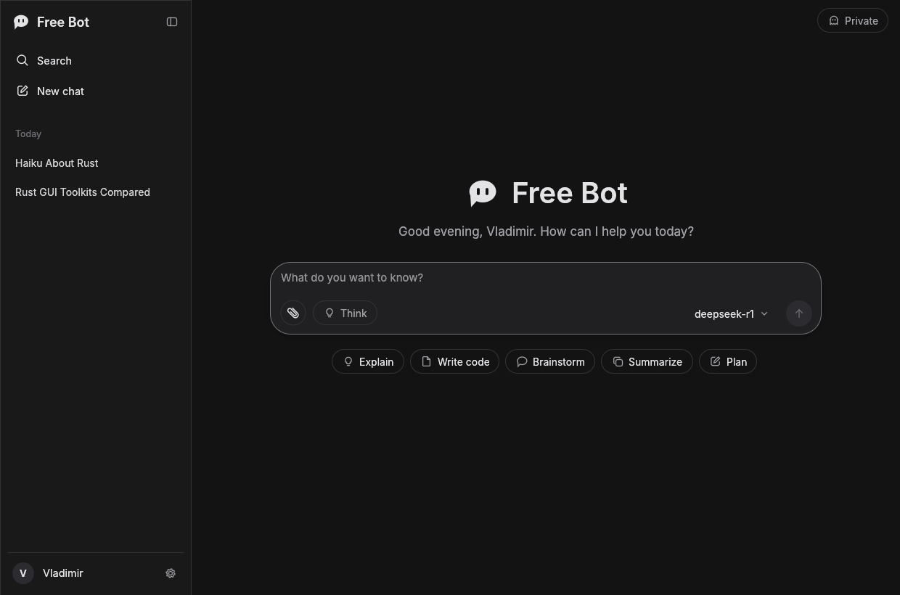
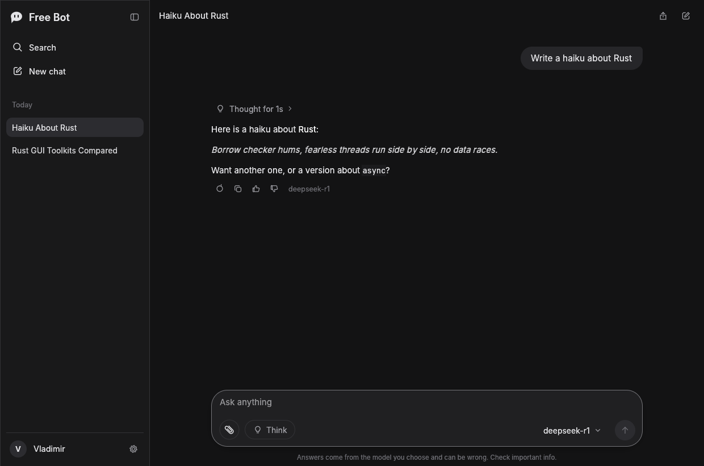
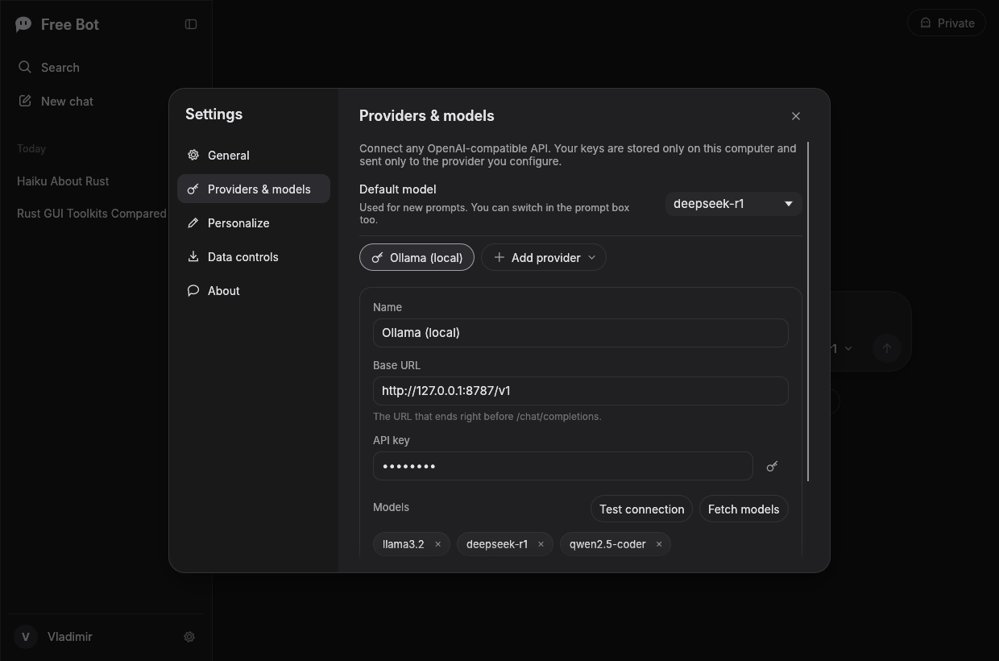
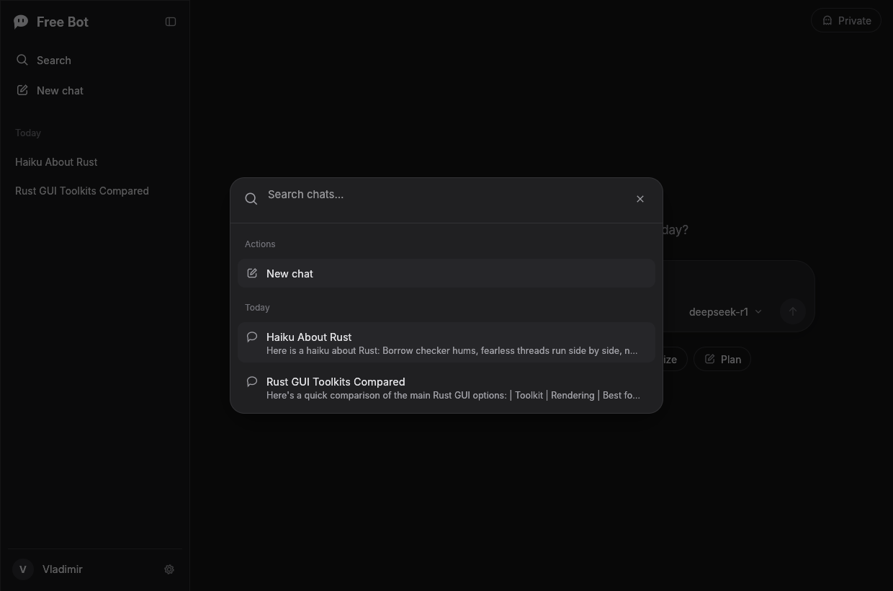
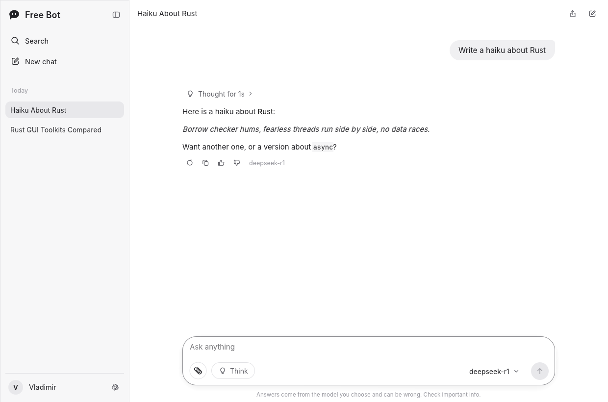

# Free Bot

A fast, native AI chat app for the desktop, written in Rust. Bring your own provider and model: Free Bot talks to any OpenAI-compatible API (OpenAI, OpenRouter, Groq, Mistral, DeepSeek, Together, Ollama, LM Studio, vLLM and more), keeps your chats on your computer, and never phones home.



| Chat with reasoning | Settings: providers and models |
|---|---|
|  |  |
| **Search chats (Ctrl+K)** | **Light theme** |
|  |  |

## Features

- **Any OpenAI-compatible provider.** Add as many providers as you like, each with a base URL, API key and model list. One click loads the model list from the provider (`GET /models`), and "Test connection" checks your key.
- **Model picker in the prompt box**, grouped by provider, plus a default model in settings.
- **Streaming answers** with a stop button (or Esc), rendered as Markdown with tables, lists, quotes and syntax-highlighted code blocks with a copy button.
- **Think mode.** Asks the model to reason before answering (`reasoning_effort: high`), and shows the reasoning in a collapsible "Thought for 6s" section. Works with `reasoning_content` / `reasoning` deltas and with models that emit `<think>…</think>` inline. If a provider rejects the parameter, Free Bot retries without it.
- **Attachments.** Attach images (sent to vision models as image parts) and text or code files (inlined into the prompt) with the paperclip or by dragging files onto the window.
- **Message actions.** Copy, regenerate (older answers stay available with `‹ 1/2 ›`), thumbs up/down, edit and resend your own messages.
- **Chat history** grouped by Pinned, Today, Yesterday, Previous 7 days, Previous 30 days and Older. Pin, rename (or double-click), export to Markdown, delete.
- **Automatic chat titles**, written by the model after the first answer.
- **Private chats** that are never saved and vanish when you leave them.
- **Search** across chat titles and messages, with keyboard navigation.
- **Share** a chat by copying it as Markdown or saving a `.md` file.
- **Personalization:** custom instructions, your name, temperature and max answer length.
- **Data controls:** export all chats to JSON, delete all chats.
- **Dark, light and system themes**, interface zoom, collapsible sidebar with an icon rail.

### Keyboard shortcuts

| Action | Shortcut |
|---|---|
| New chat | Ctrl+J (or Ctrl+Shift+O) |
| Search chats | Ctrl+K |
| Toggle sidebar | Ctrl+B |
| Private chat | Ctrl+Shift+P |
| Settings | Ctrl+, |
| Send / new line | Enter / Shift+Enter |
| Stop answering | Esc |

On macOS, Ctrl is Cmd.

## Getting started

You need a recent stable Rust toolchain (1.95 or newer).

```sh
cargo run --release
```

On first launch, click **Add provider** and pick a preset (or **Custom**), paste your API key, then click **Fetch models** or type a model id. For a local model, install [Ollama](https://ollama.com), run `ollama pull llama3.2`, and add the "Ollama (local)" preset with no key.

### Linux

Free Bot uses `winit` and `wgpu`, which load the system libraries at runtime. Most desktops already have them. On a minimal system install `libxkbcommon-x11-0` (X11), `libwayland-client0` (Wayland) and a Vulkan or GL driver such as `mesa-vulkan-drivers`. The file picker uses the XDG desktop portal.

## Where data lives

Settings and chats are stored as JSON in the platform data folder (shown in **Settings → Data controls**):

- Linux: `~/.local/share/freebot/`
- macOS: `~/Library/Application Support/dev.FreeBot.Free-Bot/`
- Windows: `%APPDATA%\FreeBot\Free Bot\data\`

`settings.json` holds your API keys, so it is created readable only by you (mode 600 on Unix). Set `FREEBOT_DATA_DIR` to use another folder.

## Why egui

The UI is built with [egui](https://github.com/emilk/egui) through `eframe`:

- **Pure Rust, one binary.** No webview, no JavaScript, no Node toolchain, so the app is easy to build and ship on Windows, macOS and Linux.
- **Immediate mode suits a chat app.** Streaming tokens, animated "thinking" indicators and live markdown are just redraws, with no widget tree to keep in sync.
- **Fully custom look.** Every surface (sidebar, prompt box, bubbles, menus, the icon set) is painted by us, so the layout can follow the familiar AI chat pattern closely without borrowing anyone's assets.
- **A path to other platforms.** `eframe` also targets the web (WASM), and egui runs on Android and iOS, which keeps the door open for the next platforms.

Tauri would have meant writing the UI in HTML/JS, and iced or Slint would have given less control over the custom chat surfaces.

## Project layout

```
src/
  main.rs        window setup
  app.rs         app state and logic: sending, streaming, titles, attachments
  api.rs         OpenAI-compatible client (SSE streaming, /models, titles)
  store.rs       data model and JSON persistence
  ui/
    mod.rs       frame loop, shortcuts, drag and drop, toasts
    sidebar.rs   brand, search, new chat, history, profile
    chat.rs      top bar, home screen, messages
    composer.rs  prompt box, attachments, Think, model picker
    modals.rs    search palette, confirmations
    settings.rs  settings dialog
    icons.rs     Free Bot's vector icon set
    theme.rs     colors, fonts, widget style
    widgets.rs   shared widgets
assets/          logo, app icon and bundled fonts
```

Run the tests with `cargo test`.

## Not in this first version

Free Bot covers the core chat experience. These are planned for later:

- Voice mode and read-aloud
- Image generation
- Web search / deep research (needs a search provider)
- Projects (grouped chats with shared files and instructions)
- PDF and Office document attachments
- Mobile and web builds

## Credits

Free Bot's name, logo and icons are original to this project. Fonts: [Inter](https://github.com/rsms/inter) (SIL Open Font License 1.1) and [JetBrains Mono](https://github.com/JetBrains/JetBrainsMono) (Apache 2.0); see `assets/fonts/`.

MIT licensed. See [LICENSE](LICENSE).
